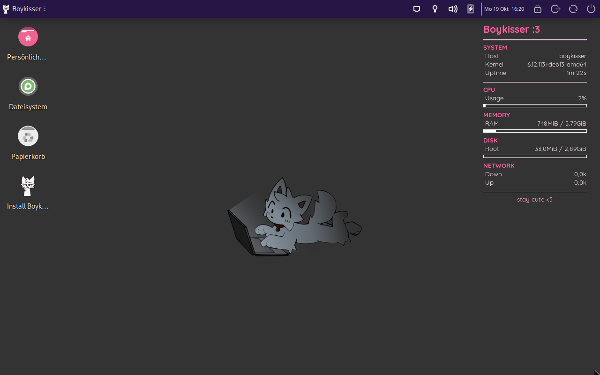
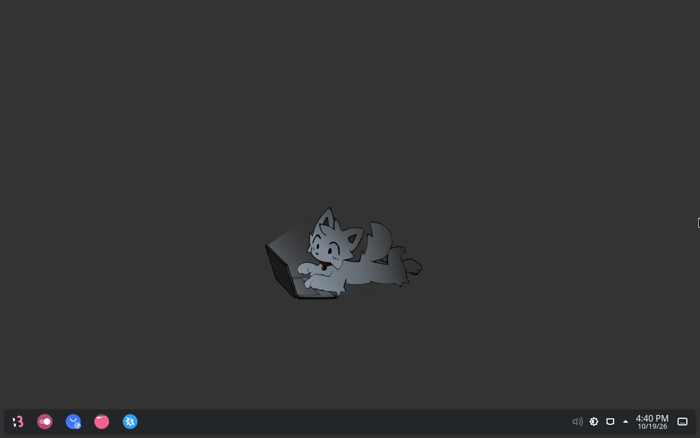
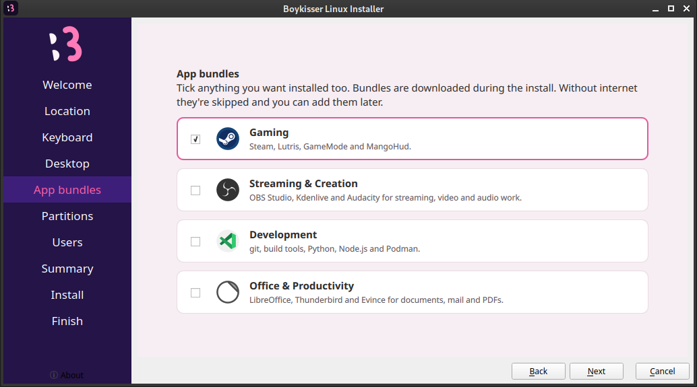
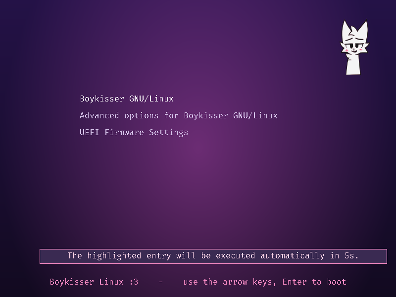

<div align="center">

<picture>
  <source media="(prefers-color-scheme: dark)" srcset="branding/src/logo.svg">
  
</picture>

# Boykisser Linux

**A pink Debian spin with XFCE or KDE Plasma.**<br>
Steam, OBS and Flatpak are set up before you first log in. Underneath it's normal Debian 13.

[](https://github.com/taynotfound/BoykisserLinux/releases/latest)
[](https://github.com/taynotfound/BoykisserLinux/actions/workflows/build.yml)
[](https://github.com/taynotfound/BoykisserLinux/actions/workflows/ci.yml)
[](https://discord.gg/3ZpwE9PPfP)

[**Website**](https://boykisser.taymaerz.de) &nbsp;·&nbsp;
[**Download**](https://github.com/taynotfound/BoykisserLinux/releases/latest) &nbsp;·&nbsp;
[**Docs**](https://boykisser.taymaerz.de/docs/getting-started/) &nbsp;·&nbsp;
[**Discord**](https://discord.gg/3ZpwE9PPfP)

<br>



</div>

<br>

## Features

<table>
<tr>
<td width="50%" valign="top">

**Pink everywhere**<br>
Boot menu, splash screen, installer, login screen, desktop, icons and six wallpapers all match. Light and dark mode switch with one click.

</td>
<td width="50%" valign="top">

**XFCE or KDE Plasma**<br>
XFCE is the default and installs offline. Pick Plasma in the installer and it's downloaded and themed the same way.

</td>
</tr>
<tr>
<td valign="top">

**Gaming**<br>
Steam with 32-bit libraries, Heroic, GameMode and MangoHud. `boykisser nvidia` installs the proprietary driver, Secure Boot included.

</td>
<td valign="top">

**Streaming**<br>
OBS Studio with the virtual camera already working, so Discord and browsers can use it.

</td>
</tr>
<tr>
<td valign="top">

**Flatpak**<br>
Flathub is set up from the start, with GNOME Software, Flatseal and Gear Lever.

</td>
<td valign="top">

**Boykisser Center**<br>
One window for updates, app packs, drivers, newer kernels, a system check and bug reports.

</td>
</tr>
<tr>
<td valign="top">

**Private and patched**<br>
No telemetry, no accounts. Firewall on, automatic security updates, zram swap, weekly TRIM and firmware updates.

</td>
<td valign="top">

**Old hardware**<br>
A Lite ISO for older BIOS-only machines that won't boot modern images.

</td>
</tr>
</table>

## Screenshots

<table>
<tr>
<td width="50%"><br><sub>KDE Plasma</sub></td>
<td width="50%"><br><sub>Boykisser Center</sub></td>
</tr>
<tr>
<td><br><sub>Installer with optional app bundles</sub></td>
<td><br><sub>Boot menu on an installed system</sub></td>
</tr>
</table>

## Download

New images are built every Monday with the current Debian kernel and security updates.

| | Size | |
| --- | --- | --- |
| **Full** | ~2.6 GB | Everything included. Installs without internet. Start here. |
| **Netinstall** | ~1.5 GB | Same desktop. The bigger apps download on first boot. |
| **Lite** | ~1.5 GB | For older BIOS-only machines. No heavy apps, safe graphics mode. |

Get them from the [latest release](https://github.com/taynotfound/BoykisserLinux/releases/latest). Every release links an Internet Archive mirror and a torrent. On GitHub the full ISO is split into parts:

```sh
cat boykisser-linux-amd64.iso.part* > boykisser-linux-amd64.iso
sha256sum --ignore-missing -c SHA256SUMS
```

Needs a 64-bit PC with 2 GB of RAM (4 GB is more comfortable) and 20 GB of disk.

## Quick start

1. Write the ISO to a USB stick with [Etcher](https://etcher.balena.io/), [Rufus](https://rufus.ie/) (DD mode) or `dd`.
2. Boot from it. The live session logs in by itself (user `live`, password `live`).
3. Double-click **Install Boykisser Linux** on the desktop.
4. After the first boot run `boykisser update`.

The [docs](https://boykisser.taymaerz.de/docs/getting-started/) cover installing, drivers, gaming, theming and troubleshooting.

## The `boykisser` command

```console
$ boykisser
  center     open the Boykisser Center
  update     update everything (apt, Flatpak, firmware, these tools)
  doctor     check the health of your system
  presets    install app packs (art, social, office, music)
  browser    pick a browser (LibreWolf, Brave, Chromium)
  theme      switch look: light | dark
  nvidia     install the proprietary NVIDIA driver
  report     open a pre-filled bug report
  ...
```

Every subcommand is a small shell script in [`tools/`](tools), packaged as a Debian package. `boykisser update` keeps them current from the `tools-v*` releases. [Full reference](https://boykisser.taymaerz.de/docs/cli/).

## Building

You need `podman` or `docker`, root (live-build creates device nodes) and about 30 GB of disk.

```sh
sudo ./build.sh                # full ISO
sudo ./build.sh --netinstall   # slim ISO
sudo ./build.sh --lite         # BIOS-only ISO
./test-vm.sh --disk            # boot it in QEMU with a virtual disk to test the installer
```

More in the [build docs](https://boykisser.taymaerz.de/docs/building/).

## Repository

| Path | |
| --- | --- |
| [`auto/`](auto), [`config/`](config) | live-build definition of the ISO: packages, build hooks, files copied into the system, boot menu |
| [`tools/`](tools) | the `boykisser-*` scripts and the Boykisser Center |
| [`web/`](web) | the website and docs (Astro + Starlight), deployed by Vercel |
| [`branding/`](branding) | logo SVGs and the script that renders every brand image |
| [`scripts/`](scripts) | release helpers (version tag, Discord announcements, local auto-rebuild) |
| [`.github/workflows/`](.github/workflows) | CI, weekly ISO builds, ISO and tools releases |

## Releases

- **ISOs.** CI tags `vM.YY.N` every Monday and builds all three versions. They go to GitHub Releases and the Internet Archive and are announced on Discord. Tag one by hand with [`scripts/bump_version.sh`](scripts/bump_version.sh).
- **Tools.** Bump [`tools/VERSION`](tools/VERSION) and push a matching `tools-vX.Y.Z` tag.

## Contributing

Bug reports are easiest from the OS itself: `boykisser report` (or **Report a Problem** in the menu) opens a GitHub issue with basic system info filled in. Pull requests are welcome. For anything big, say hi on [Discord](https://discord.gg/3ZpwE9PPfP) first.

<br>

<div align="center">
<sub>Boykisser is a community meme character and this is unofficial fan work. Not affiliated with Debian. Debian is a trademark of Software in the Public Interest, Inc.</sub>
</div>
