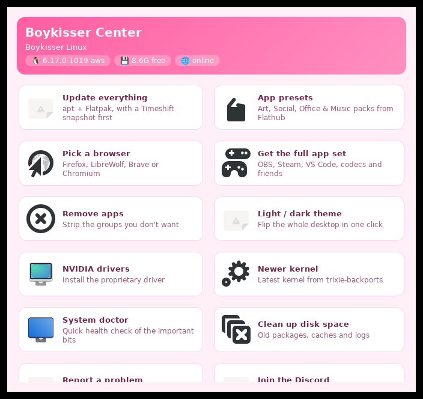

The **Boykisser Center** is one window for the things you'd otherwise look up commands for. Open it from the app menu, or run `boykisser center`.

The banner at the top shows your version, kernel, free disk space, the installed tools version and whether you're online. Below it, the tiles are grouped:

## System

| Tile | Does | Same as |
| --- | --- | --- |
| Install to disk | Starts the installer (live session only) | `boykisser install` |
| Update everything | apt, Flatpak, firmware and the Boykisser tools | `boykisser update` |
| System doctor | Read-only health check | `boykisser doctor` |
| Clean up disk space | Unused packages, apt cache, old logs, thumbnails | `boykisser cleanup` |
| NVIDIA drivers | Installs the proprietary driver | `boykisser nvidia` |
| Newer kernel | Latest kernel from Debian backports | `boykisser kernel --install` |
| Autologin | Toggle logging in without a password (installed systems) | `boykisser autologin` |

## Apps

| Tile | Does | Same as |
| --- | --- | --- |
| App presets | Art, Social, Office and Music packs from Flathub | `boykisser presets` |
| Get the full app set | OBS, Steam, VS Code, codecs (for netinstall/lite) | `boykisser apps` |
| Pick a browser | LibreWolf, Brave or Chromium | `boykisser browser` |
| Remove apps | Removes app groups you don't use | `boykisser debloat` |

## Look & feel and help

| Tile | Does | Same as |
| --- | --- | --- |
| Light / dark theme | Flips the whole desktop | `boykisser theme light` / `dark` |
| Next wallpaper | Cycles the Boykisser wallpapers | `boykisser wallpaper --next` |
| Welcome checklist | The first-steps guide | `boykisser welcome` |
| Report a problem | Opens a pre-filled GitHub issue | `boykisser report` |
| Join the Discord | Opens the invite | |

Tiles that do system work open a terminal so you can see what's happening and type your password. The terminal stays open when it's done so you can read the result.

The Center follows your light or dark theme, so it never clashes with the rest of the desktop.
